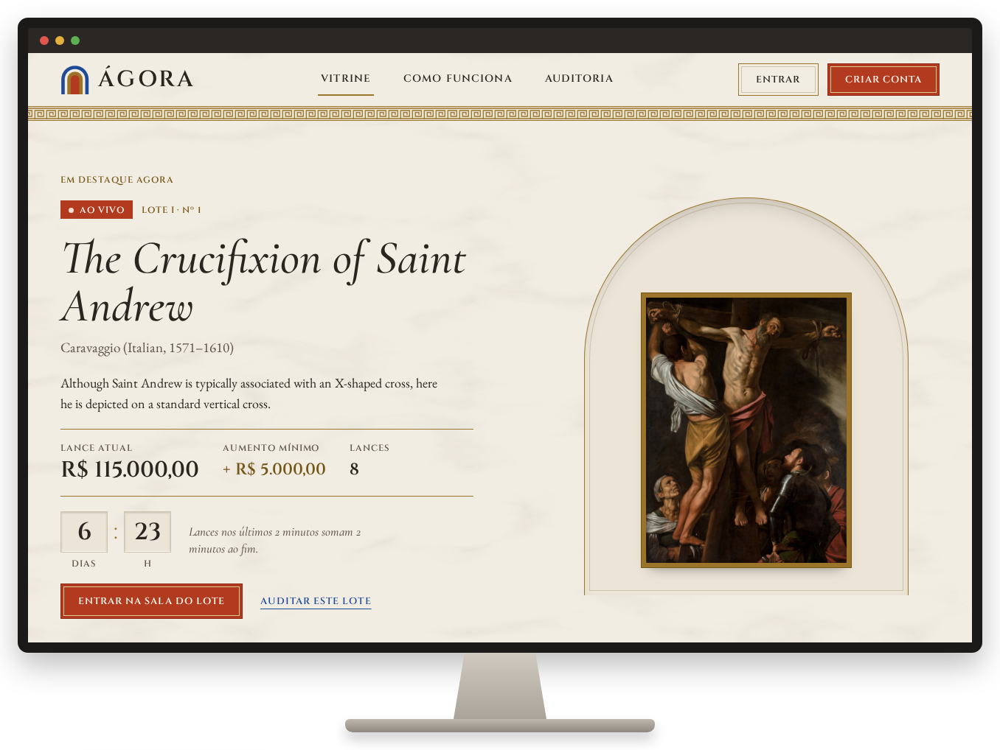
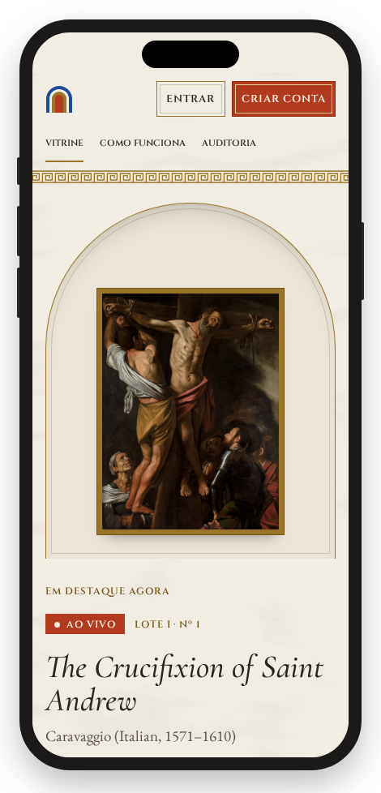
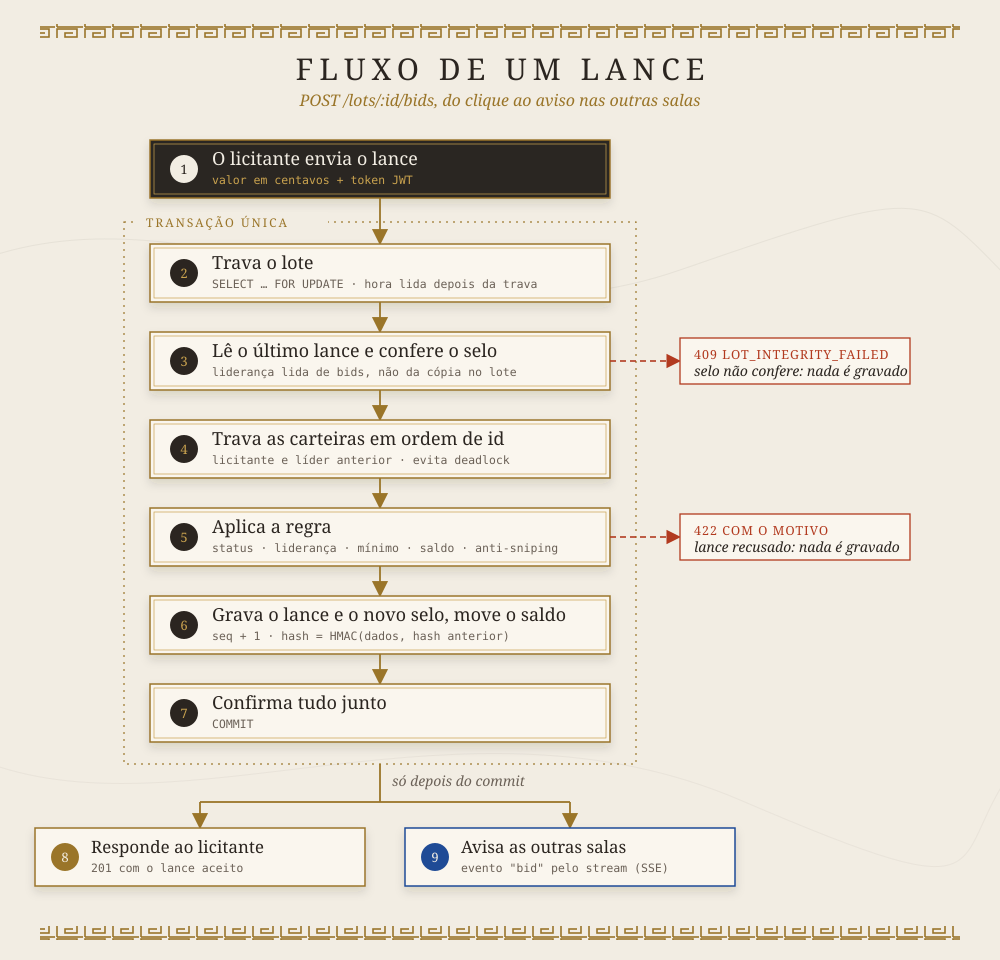
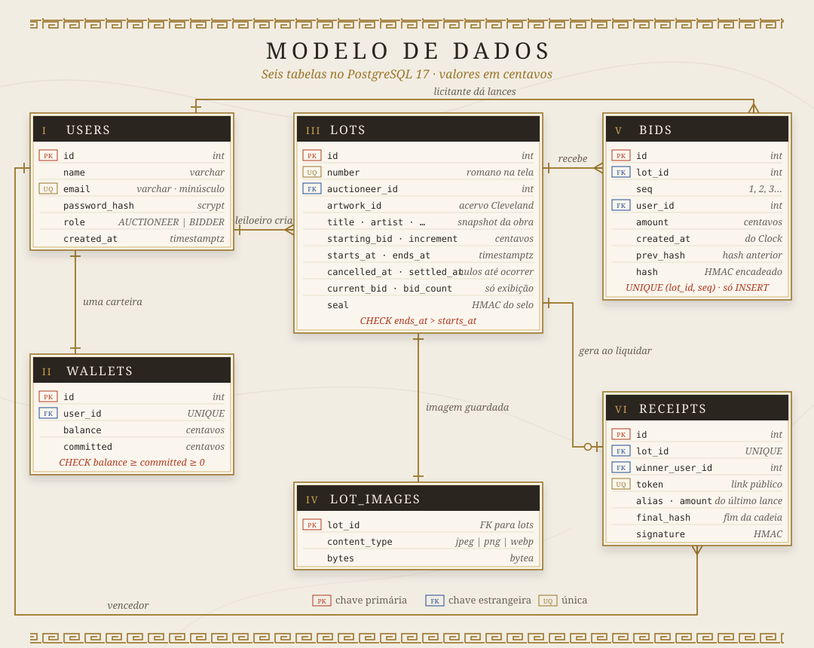
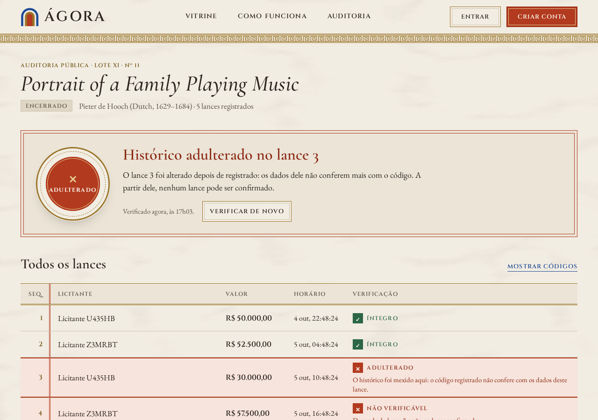

<p align="center"></p>

<p align="center">


</p>

<p align="center">


</p>

<p align="center"><em>Como na praça de Atenas: tudo à vista, e qualquer pessoa pode conferir.</em></p>

Ágora é uma casa de leilões online de arte clássica europeia. As obras vêm do acervo aberto do Cleveland Museum of Art: o leiloeiro escolhe uma peça e cria o lote, os licitantes dão lances ao vivo com o saldo de uma carteira simulada, e qualquer pessoa, sem login, confere se o histórico de lances de um lote foi alterado.

**App:** https://agora-web-gp1g.onrender.com · **API:** [`/health`](https://agora-api-w6z9.onrender.com/health)
O primeiro acesso pode levar até 1 min: a API dorme após 15 min sem tráfego (plano free do Render).

[I · O que dá para fazer](#i--o-que-dá-para-fazer) · [II · Testar agora](#ii--testar-agora) · [III · Regras do leilão](#iii--regras-do-leilão) · [IV · Rodar local](#iv--rodar-local) · [V · Arquitetura](#v--arquitetura) · [VI · Modelo de dados](#vi--modelo-de-dados) · [VII · Auditoria](#vii--auditoria) · [VIII · Comportamentos esperados](#viii--comportamentos-esperados) · [IX · Testes](#ix--testes) · [X · Decisões principais](#x--decisões-principais) · [XI · Identidade visual e processo de design](#xi--identidade-visual-e-processo-de-design) · [XII · Fora do escopo](#xii--fora-do-escopo) · [XIII · Uso de IA](#xiii--uso-de-ia)

<p align="center"></p>

## I · O que dá para fazer

- **Vitrine:** lotes ao vivo, agendados e encerrados, com busca por título, artista ou número do lote, e um destaque com os lances chegando ao vivo.
- **Sala do lote:** lance com atalhos de valor, contagem regressiva pela hora do servidor, histórico em tempo real e a situação do licitante ("ganhando" ou "superado", com a posição).
- **Carteira:** depósito simulado, saldo disponível e os lotes em que o saldo está comprometido.
- **Meus lances:** lotes em andamento, arrematados e não arrematados, com o link do comprovante.
- **Painel do leiloeiro:** busca no acervo do museu, criação de lote, livro de lotes com filtros, resultado, total recebido e cancelamento.
- **Auditoria pública:** veredito do lote e cada lance com o seu código, sem login; o comprovante de arremate também é público.

<p align="center"></p>

## II · Testar agora

| Conta | E-mail | Papel |
|---|---|---|
| Casa Ágora | `leiloeiro@agora.dev` | Leiloeiro, dono de todos os lotes |
| Geovanna | `geovanna@agora.dev` | Licitante |
| Felipe | `felipe@agora.dev` | Licitante |

Senha de todas: `Agora2026!` (também na tela Entrar, que preenche o formulário com um clique).

O seed cria 11 lotes: 4 ao vivo (um disputado, um liderado por cada licitante e um sem lances), 2 agendados, 3 encerrados e liquidados (um para cada licitante e um sem lances), 1 cancelado e o lote XI, encerrado e adulterado de propósito.

1. Entre como Geovanna e cubra o lance de Felipe no lote III.
2. Numa janela anônima, entre como Felipe na mesma sala e veja o lance chegar ao vivo, com "Você foi superado" e a posição.
3. Entre como Casa Ágora, cancele no painel um lote ao vivo com lances e veja na Carteira do líder o comprometido voltar para o disponível.
4. Em Meus lances, copie o link do comprovante de um lote arrematado e abra numa janela anônima: a assinatura é conferida na hora.
5. Na página inicial, audite o lote XI (o campo aceita 11 ou XI): o lance 3 foi trocado de R$ 55.000 para R$ 30.000 direto no banco, e o veredito acusa.

<p align="center"></p>

## III · Regras do leilão

A hora de referência é sempre a do servidor, e toda recusa volta com um código estável que o front traduz.

- **Lance só ao vivo:** antes do início responde `LOT_NOT_STARTED`, depois do fim `LOT_ENDED`; o status sai do horário, não de coluna (D-010).
- **Primeiro lance e incremento:** o primeiro lance vale ao menos o lance inicial; os seguintes, o lance atual mais o incremento do lote, senão `BID_BELOW_MINIMUM` (D-043).
- **Líder não cobre o próprio lance:** responde `ALREADY_WINNING` (D-043).
- **Saldo comprometido:** o valor do lance que lidera fica reservado na carteira; sem disponível, `INSUFFICIENT_BALANCE` (D-042).
- **Devolução ao superado:** o comprometido do líder anterior volta na mesma transação do lance que o cobre, com lock no lote e nas carteiras (D-014).
- **Anti-sniping:** lance aceito com 2 min ou menos para o fim soma 2 min ao fim atual, e o novo fim chega pelo stream (D-011).
- **Liquidação:** no fim, o vencedor é debitado, o leiloeiro creditado e o comprovante assinado, numa transação só (D-009, D-029).
- **Cancelamento com estorno:** o leiloeiro cancela lote próprio agendado ou ao vivo; com lances, o comprometido do líder é devolvido (D-070).

<p align="center"></p>

## IV · Rodar local

Pré-requisito: Docker. Front em http://localhost:5173, API em http://localhost:3000; as migrations rodam no boot da API.

```bash
docker compose up --build
docker compose exec api npm run seed   # em outro terminal
```

O seed cria tudo pelos services da aplicação, baixando obras e imagens da Cleveland na hora, e é idempotente: rodar de novo completa o que faltou sem duplicar.
Hot reload, migrations, seed fora do compose e as limitações do Render free: [`docs/desenvolvimento.md`](docs/desenvolvimento.md).

### Adulterar o histórico você mesmo

Só no ambiente local do compose, nunca em produção. Os comandos mexem só nos lotes encerrados VII e VIII:

```bash
psql() { docker compose exec db psql -U agora -d agora -c "$1"; }
# 1. Valor de um lance: o lote 8 passa a "Adulterado" no lance 2. Desfazer: o mesmo com "- 100000".
psql "UPDATE bids SET amount = amount + 100000 WHERE seq = 2 AND lot_id = (SELECT id FROM lots WHERE number = 8)"
# 2. Valor do comprovante (com o 1 desfeito): a auditoria do lote 8 acusa o comprovante. Desfazer: "+ 100000".
psql "UPDATE receipts SET amount = amount - 100000 WHERE lot_id = (SELECT id FROM lots WHERE number = 8)"
# 3. Último lance apagado: o lote 7 acusa lances removidos do fim. Sem desfazer.
psql "DELETE FROM bids WHERE seq = 4 AND lot_id = (SELECT id FROM lots WHERE number = 7)"
```

<p align="center"></p>

## V · Arquitetura

API em NestJS com um módulo por domínio (`auth`, `users`, `wallets`, `catalog`, `lots`, `bids`, `settlement`, `audit`, `receipts`) e front em React por feature, tudo no Render free (API, site estático e Postgres).

<p align="center"></p>

A liquidação roda num timer em memória apontado para o próximo fim, recalculado no boot, a cada lance e a cada lote criado, e também no primeiro acesso a um lote vencido, porque a API do plano free dorme.
Timer e acessos simultâneos liquidam uma vez só: o lote é travado com `FOR UPDATE` e o comprovante tem `UNIQUE (lot_id)` (D-009).

<p align="center"></p>

## VI · Modelo de dados

<p align="center"></p>

Dinheiro em centavos (`integer`); `bids` só recebe inserção; `current_bid` e `bid_count` no lote são cópias para exibição, e liderança, mínimo e vencedor saem sempre do último lance da cadeia (D-042).

<p align="center"></p>

## VII · Auditoria

Cada lance guarda um HMAC do lote, da ordem, do licitante, do valor, da data e do hash do lance anterior: mudar, inserir, apagar ou reordenar um lance quebra a cadeia, e só o servidor tem o segredo para assinar de novo (D-012). O lote guarda um selo com a contagem e o último hash, que acusa lances apagados do fim. O comprovante assina o lote, o apelido do vencedor, o valor, o hash final e a data da liquidação, e é conferido a cada abertura. Um segredo só, com prefixo por contexto (`bid:`, `seal:`, `alias:`, `receipt:`) em formato fixo, para uma assinatura nunca valer em outro lugar (D-056).

A tela `/lots/:id/audit` dá um de quatro vereditos, nesta prioridade: íntegro, adulterado (com o primeiro lance quebrado), lances removidos do fim ou comprovante divergente (D-065). Cada lance aparece como íntegro, adulterado ou não verificável. Limitação: restaurar o banco inteiro (lote e lances) para um estado anterior não é detectado, porque o hash não é ancorado fora do banco.

<p align="center"></p>

<p align="center"><sub>A auditoria do lote XI aponta o lance alterado direto no banco.</sub></p>

<p align="center"></p>

## VIII · Comportamentos esperados

- Cleveland fora do ar não derruba vitrine, sala, auditoria nem comprovante: obra e imagem ficam no banco; só a busca no acervo e a criação de lote dependem dela (D-004).
- As imagens da busca no acervo vêm direto da CDN do museu e podem demorar; nas telas de lote, a imagem sai da API.
- Lote com selo divergente da cadeia não aceita lance (`LOT_INTEGRITY_FAILED`) nem é liquidado, para não apagar a evidência (D-059, D-064).
- O login aceita 5 tentativas por minuto por IP; a 6ª responde `TOO_MANY_ATTEMPTS` (D-068).
- A sessão dura 8h e não renova (D-006).
- Com a Carteira aberta, um lote que venceu continua "você lidera" até recarregar a página.
- O licitante aparece com um apelido diferente em cada lote, nunca com nome ou e-mail (D-013).
- Os textos das obras ficam em inglês, como no acervo da Cleveland (D-038).
- Os cards da vitrine mostram o estado do carregamento da página; só o destaque atualiza ao vivo, porque um stream por card estouraria o limite de conexões do navegador.
- O leiloeiro não tem tela de carteira: o arremate é creditado na carteira dele, e o painel mostra o total recebido pelos comprovantes (D-039).
- O stream de lances vive na memória de uma instância só da API, o que basta no plano free, que roda uma instância.
- O banco é recriado e o seed roda de novo no dia da entrega, porque o Postgres free expira 30 dias após a criação: nada depende de dados anteriores.

<p align="center"></p>

## IX · Testes

```bash
cd api && npm test           # Jest, unitários ao lado de cada arquivo
cd api && npm run test:e2e   # integração contra Postgres real (exige Docker)
cd web && npm test           # Vitest
```

- **TDD:** regras de lance, saldo comprometido e anti-sniping (4.1), cadeia de HMAC e selo (4.2), liquidação (5.1) e auditoria (5.5), com o commit do teste vermelho antes da implementação (D-055).
- **e2e:** Postgres 17 de verdade via Testcontainers e a API por HTTP: 10 lances simultâneos no mesmo lote, cancelamento com estorno e adulteração feita direto no banco.
- **Branches:** o merge na `main` é por squash (D-021), então cada story vira um commit só; as branches das stories são mantidas de propósito, porque guardam o passo a passo de cada uma (teste vermelho antes da implementação nas stories com TDD e correções da revisão, D-055). Num projeto normal elas seriam apagadas depois do merge.
- **CI:** GitHub Actions roda lint, testes unitários, e2e e build dos dois lados, e valida o título da PR e o limite de linhas deste README.

<p align="center"></p>

## X · Decisões principais

- Cada lance numa transação única, com lock de linha no lote e nas carteiras em ordem de `id` (D-014).
- Cadeia de HMAC nos lances, mais um selo no lote, para a auditoria pública (D-012).
- Liquidação por timer em memória e no acesso ao lote vencido, sem job periódico (D-009).
- Obra e imagem copiadas para o banco na criação do lote (D-004).
- Tempo real por SSE, com apelido público por lote (D-005).

São 70 decisões, com as alternativas descartadas, em [`docs/decisions.md`](docs/decisions.md); o mapa dos documentos está em [`docs/README.md`](docs/README.md).

<p align="center"></p>

## XI · Identidade visual e processo de design

<p align="center"></p>

<p align="center"><sub><em>A Escola de Atenas</em>, Rafael, 1509–1511 (domínio público). A referência visual do projeto.</sub></p>

A vontade de fazer um site com design clássico veio antes do projeto. O tema de leilão de obras de arte foi escolhido para dar espaço a essa linguagem visual.

A referência foi _A Escola de Atenas_, de Rafael: dela saíram as cores, os estilos e os detalhes, como o arco, o mármore e os dourados. Com essa base, as telas foram desenhadas no Claude Design como um monumento greco-romano, mas mantendo a interface moderna e fácil de usar. Os desenhos estão em [`docs/design`](docs/design).

Evitei de propósito o visual padrão de interface gerada por IA, com caixas de bordas arredondadas por toda parte e um design chamativo e moderno demais. Busquei algo mais refinado e agradável aos olhos: cantos retos, filetes dourados, mármore e tipografia de inscrição.

O nome vem do grego antigo: ágora era a praça pública onde aconteciam o comércio e a vida da cidade. Numa tradução direta, algo como "mercado".

Paleta: mármore `#f2ede3`, tinta `#2b2520`, ouro `#9a7529`, cinábrio `#b23a1f`, ultramar `#1f4b96` e malaquita `#2c6646`. Fontes: Cinzel nos títulos, Cormorant Garamond e EB Garamond no texto.

<p align="center"></p>

## XII · Fora do escopo

- Documentação da API com Swagger.
- Tema escuro (opcional do enunciado); o desenho existe em [`docs/design`](docs/design).
- Cancelar lote já arrematado: desfaria a liquidação e o comprovante.
- Extrato da carteira: ela mostra só saldo, comprometido e disponível.
- Pagamento real: o depósito é simulado.

<p align="center"></p>

## XIII · Uso de IA

**Planejamento (3 dias, antes da primeira linha de código).** Alinhei o design, as regras de negócio, os gargalos e a arquitetura: como travar os lances (lock na transação, D-014), se a sala ao vivo usaria WebSocket (Socket.IO) ou SSE (D-005) e como provar que o histórico não foi mexido (D-012). Disso saiu o [`CLAUDE.md`](CLAUDE.md), com o jeito de trabalhar: TDD nas regras críticas, sem comentários desnecessários e sem nomes de função longos demais. Com ele e a primeira story (o esqueleto no ar), usei o BMAD para organizar tudo em épicos e depois em stories.

Cada story seguiu o mesmo ciclo:

1. Abro a story no BMAD com o contexto do que quero.
2. Alinho as decisões e aprovo os casos de teste antes do código.
3. O Claude Code implementa, e revisores automáticos procuram falhas.
4. Analiso o que a revisão pegou e decido, usando o Claude (app) para pesquisa e dúvidas.
5. Passo as decisões novas, se houver, e peço o push e a PR.
6. Reviso o código em busca de erros e inconsistências e aprovo o merge depois do CI verde.

Alguns destaques:

- **Cadeia de HMAC com selo (D-012):** a cadeia sozinha não acusa lances apagados do fim; o selo no lote fecha esse buraco. A IA fez o selo igual para todos os lotes sem lances, e quem apagasse os lances de um poderia copiar o selo de outro; pedi o lote dentro do selo, com testes.
- **Liquidação sem job periódico (D-009):** a API do plano free dorme, então o timer em memória não basta e o lote vencido também é liquidado no primeiro acesso. Pedi ainda que um selo divergente bloqueasse a liquidação (D-064).
- **Snapshot da obra (D-004):** obra e imagem vão para o banco na criação do lote, para a sala, a auditoria e o comprovante nunca dependerem da Cleveland.
- **Erros da IA pegos na revisão:** ela afirmou que o comum era o leilão acabar 2 min depois do lance de última hora; conferido, a casa citada no enunciado soma 2 min ao fim atual (D-011). Também sugeriu decidir o cancelamento por um contador de lances sem proteção contra adulteração, o que recusei.

Registro completo, por story: [`docs/ai-log.md`](docs/ai-log.md).
